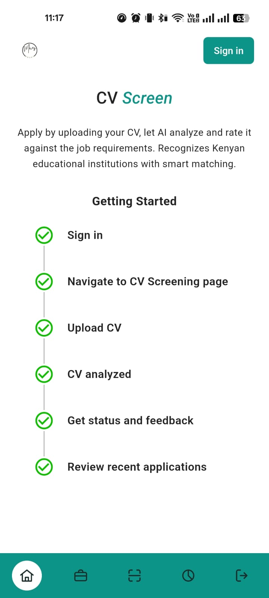

# cvscreen

A Flutter app for AI-assisted CV screening. Candidates upload their CV against
an advertised job; an n8n workflow scores it and writes the result back for both
the candidate and the recruiter to view.

## Features

- Candidate sign-in (email/password and Google) and recruiter accounts
- Browse advertised jobs and submit a CV to a role
- AI scoring per application (skill, experience, education, certification matches)
- Recruiter views: manage jobs, review applicants, and manage user accounts

## Stack

- **Flutter** (Dart): single codebase for mobile and web
- **Supabase**: authentication and Postgres data
- **n8n**: CV screening workflow triggered via webhook

## Getting started

1. Provide the Supabase URL/anon key and the n8n webhook URL in the app's
   environment config.
2. Run `flutter pub get`.
3. Apply the SQL in `supabase/` through the Supabase dashboard.
4. Launch with `flutter run`.
